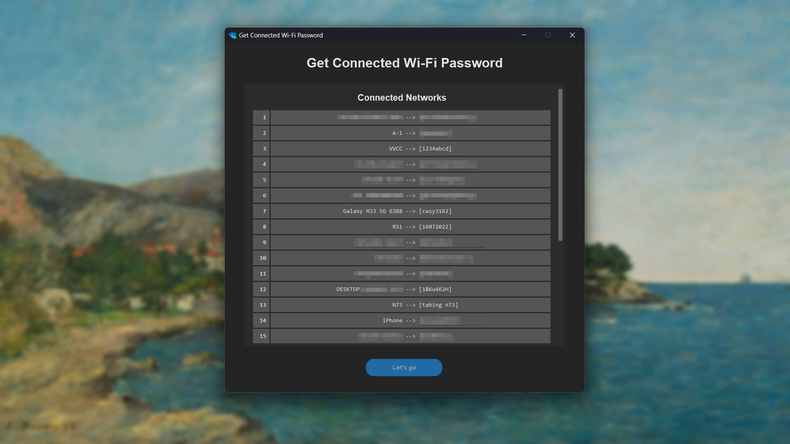

# Get Connected WiFi Password Application using Python customtkinter

I'm using Python `3.11.9`



## How to run without Python

1. Download this repository to zip
2. Extract the zip file you've donwloaded
3. Go to `dist/`
4. Finally, run the `Connected Networks.exe`

## How to compile `.py` to `.exe` (pyinstaller)

```bash
# Compile normal
pyinstaller main.py

# Compile with no terminal
pyinstaller main.py --windowed

# Compile into single file and no terminal
pyinstaller main.py --onefile --windowed

# Compile into single file, no terminal, and set icon app
pyinstaller main.py --onefile --windowed --icon="assets/icons8-wifi-96.ico"

# Compile into single file, no terminal, set icon app, and set name for the app after compiled
pyinstaller main.py --onefile --windowed --icon="assets/icons8-wifi-96.ico" --name="Connected Networks"
```

> This project compiled using `auto-py-to-exe`. I recommend to compile any python file using `auto-py-to-exe` than `pyinstaller`.
